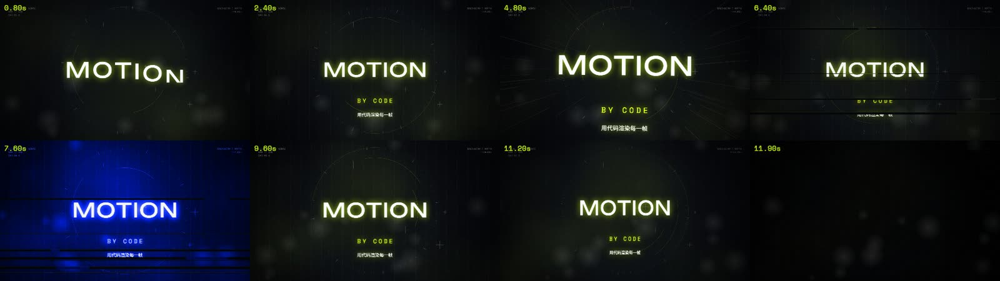
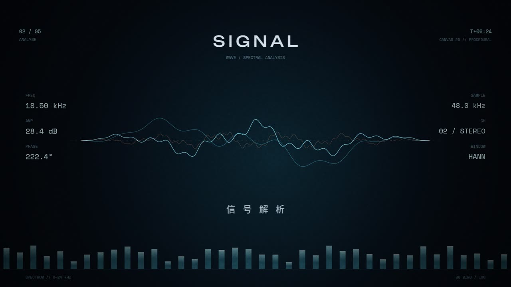
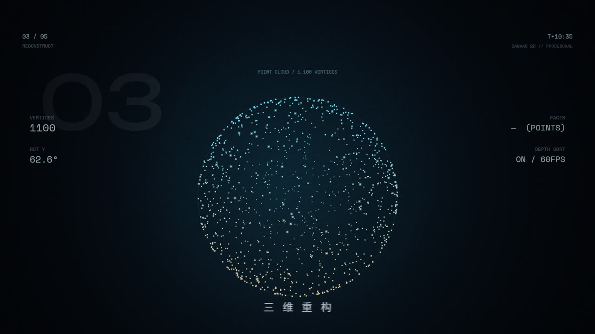
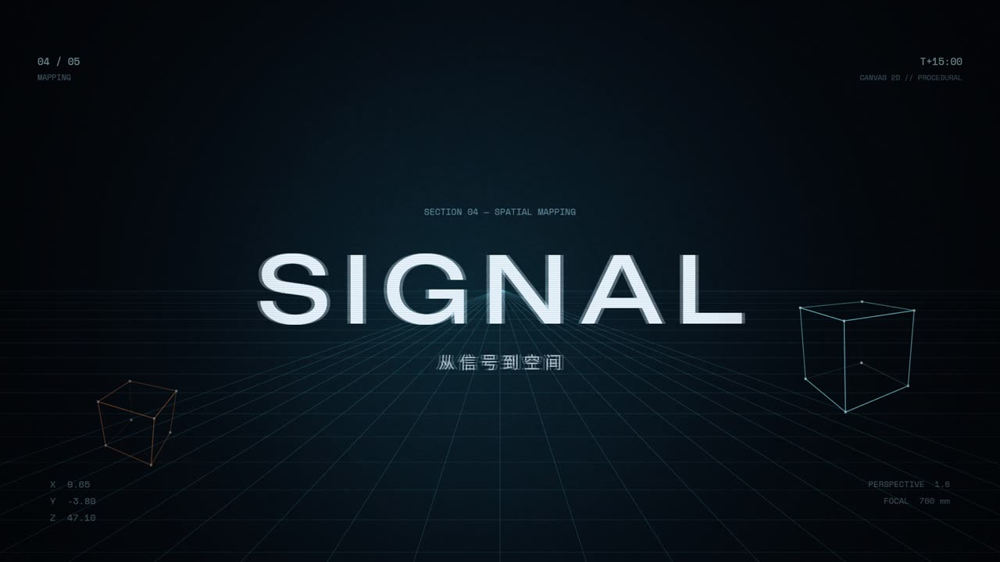
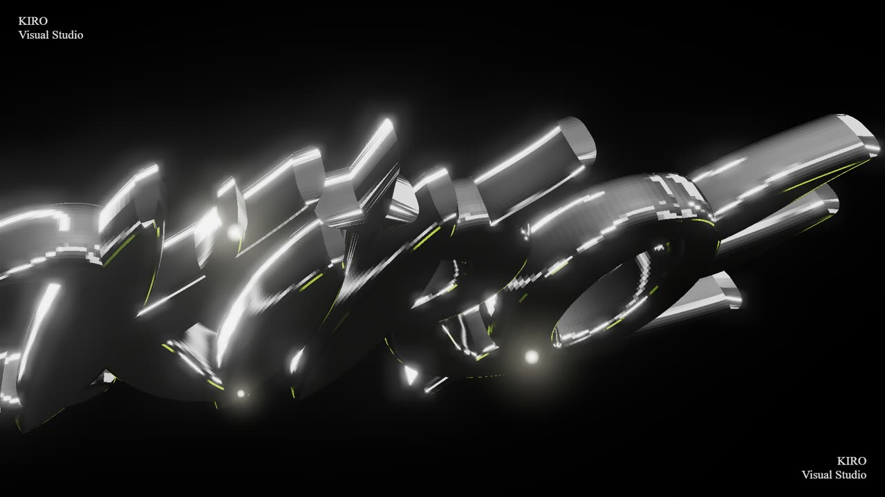

<div align="center">

# Motion Forge

**Frame-by-frame motion graphics, written as code. No After Effects, no stock footage.**

[](NOTICE)
[](package.json)
[](#requirements)
[](CONTRIBUTING.md)

[中文](README.md) · [Quick start](#quick-start) · [Methodology](references/methodology.md) · [Upstream](#relationship-to-upstream)



<sub>Eight-frame storyboard produced by a single command on `examples/opener.js` (`sheet` mode, ~3 s).</sub>

</div>

---

## What this is

A **motion-graphics engine** plus a methodology that turns subjective taste into executable parameters.

Every frame is computed: no timeline scrubbing, no compositing, no project files. You write a script; the script computes the picture; the picture goes straight into ffmpeg.

```bash
git clone https://github.com/cxcmyt/motion-forge.git && cd motion-forge
npm install --omit=dev        # ~98 MB, 20 s
node scripts/verify.js        # seven-point self-check
node examples/opener.js still 9.6 out/first.jpg
```

If `verify.js` is all green, you own a machine that makes motion graphics.

---

## Why it exists

The approach comes from [KRYPT-123/kiro-motion-studio](https://github.com/KRYPT-123/kiro-motion-studio), but that repo **does not run out of the box** — four hardcoded paths that only exist in the author's Linux sandbox. Motion Forge fixes it, adds two retitleable templates, and documents every trap hit along the way.

| Upstream problem | Consequence | Fix here |
|---|---|---|
| 4 scripts hardcode `/opt/pw-browsers/chromium-1243/chrome-linux64/chrome` | Crashes anywhere else | `tools/chrome.js`: `KIRO_CHROME` → `ms-playwright` cache (newest first) → system Edge/Chrome |
| 2D scripts read `../fonts/`, directory absent | `ENOENT` at startup | 6 WOFF files bundled in `assets/fonts/`, upstream scripts unmodified |
| No CJK glyphs (upstream lists it as a "known trap", no fix) | Chinese renders as tofu | System font registered at runtime as the alias `Noto Sans SC` |
| Dependencies scattered per example | Three installs, version drift | Single top-level `package.json` + lockfile |

`KIRO_GL=d3d11` (Windows dGPU) / `metal` (macOS) switches to hardware GL — measured several times faster.

---

## Features

- **Two pipelines**: 2D via `@napi-rs/canvas` → raw RGBA piped into ffmpeg (**lossless**); 3D via three.js + headless Chromium screenshots.
- **Cross-platform**: one codebase for Windows / macOS / Linux, browser resolved at runtime.
- **Zero assets**: everything comes from math and deterministic hashes — reproducible frames, diffable changes.
- **Beat-accurate**: `B(n) = B0 + n·BP` grid; shot lengths snap to whole bars instead of eyeballing.
- **Retitle, not rebuild**: each template has one `CFG` block; four constants make a new film.
- **Self-checking**: seven-point `verify.js`; `sheet` mode renders a storyboard in ~3 s so you judge rhythm before paying for the full render.

---

## Preview

Three shots, all default output of `signal20.js`:

| Waveform analysis | Point-cloud rebuild | Spatial mapping |
|---|---|---|
|  |  |  |

3D route (three.js + headless Chromium — requires fetching the upstream scripts, see [Optional: 3D](#optional-3d-pipeline)):



---

## Requirements

| Dependency | Version | Notes |
|---|---|---|
| Node.js | ≥ 20 | Uses `node:` prefixes and modern V8 |
| ffmpeg | ≥ 6 | Must be on `PATH`; `ffprobe` too |
| Chromium | any recent | Playwright cache is picked up automatically, else system Edge / Chrome |
| git | any | Only needed to fetch the optional upstream reference |

No GPU required (swiftshader software rendering by default) — 3D costs ~0.8 s/frame that way.

---

## Quick start

```bash
# 1. Install runtime dependencies (~98 MB)
npm install --omit=dev

# 2. Self-check: node / ffmpeg / browser / deps / fonts / CJK glyphs
node scripts/verify.js

# 3. Render the first still
node examples/opener.js still 9.6 out/first.jpg
```

`verify.js` tells you exactly which check failed and how to fix it. A warning that upstream has not been fetched is expected — 3D is optional.

---

## Usage

All scripts share one command set: `still` / `sheet` / `video`.

```bash
# Single frame (fastest way to judge composition)
node examples/opener.js still 9.6 out/a.jpg

# Storyboard thumbnail (whole rhythm in one image — run this after every edit)
node examples/opener.js sheet 1.2,4.4,6.4,9.6,11.8 out/sheet.jpg

# Full render: video <fps> <output>
node examples/opener.js video 60 out/opener-1080p60.mp4
node examples/signal20.js video 60 out/signal-1080p60.mp4

# Everything at once (stills + storyboards, ~40 s)
npm run render:samples
```

**Three-step QA, always**: `still` for composition → `sheet` for rhythm → `video` for delivery. Watching a finished render to discover a rhythm problem costs an order of magnitude more.

### Optional: 3D pipeline

The 3D scene scripts belong to the upstream author and are deliberately **not distributed here**. Fetch them into your own machine when you need them:

```bash
node scripts/fetch-upstream.js            # clones upstream into ./upstream/ (gitignored)
npm run bundle:3d                         # esbuild the three.js scene
node upstream/examples/kiro-3d-logo/drive.js stills 1.0,5.0 out/3d
node upstream/examples/kiro-3d-logo/drive.js video out/3d/logo.mp4 0 300
```

The fetch script rewrites the hardcoded browser path in those four scripts to `tools/chrome.js`, otherwise they cannot start on your machine. Rationale and legal boundary: [NOTICE](NOTICE).

---

## Retitle a film

Each template opens with a `CFG` block:

| Field | Meaning |
|---|---|
| `main` | Headline (Latin, Unbounded) |
| `sub` | Subtitle (Space Mono) |
| `cn` | Chinese line (`Noto Sans SC` alias) |
| `bpm` | Tempo; `BP = 60 / bpm`, every timestamp derives from `B(n) = B0 + n·BP` |
| `accent` | Accent colour |

Then render. **Don't touch the functions below** — the timeline and shot switches hang off the `SHOTS` array, and editing them breaks beat alignment.

---

## Methodology

Full version in [`references/methodology.md`](references/methodology.md) (Chinese). The five rules:

1. **Every frame is computed** — randomness comes from deterministic hashes, so frames reproduce and diffs are meaningful.
2. **Grid before shots** — fix BPM and phase first, then snap shot lengths to whole bars.
3. **At least 4 layers per shot** — background → decoration → subject → foreground, then chromatic aberration / grain / vignette in post.
4. **Quantify the aesthetics** — aberration 1–1.5 px normally, 4–6 px on kicks; grain 0.05; vignette 0.35–0.46; crf 16–17.
5. **Mix frame rates** — subject at 60 fps, freeze-frame elements at 12 fps; the juxtaposition reads as craft.

---

## Repository layout

```
motion-forge/
├── SKILL.md                    Skill entry point (loadable by AI assistants)
├── manifest.json               Skill metadata
├── LICENSE / NOTICE            MIT · OFL-1.1 · upstream statement
├── examples/                   ★ Original templates (MIT)
│   ├── opener.js               12 s beat-synced opener
│   └── signal20.js             20 s procedural tech film
├── assets/fonts/               6 WOFF files (OFL-1.1)
├── tools/chrome.js             Cross-platform Chromium resolver
├── scripts/
│   ├── verify.js               Seven-point environment check
│   ├── render-samples.js       Batch render all samples
│   └── fetch-upstream.js       Optional upstream fetcher
├── references/
│   ├── methodology.md          Timeline / layers / parameters / QA checklist
│   └── local-port.md           Port log and 9 traps
├── docs/preview/               Images used by these READMEs
└── upstream/                   ⚠ Generated at runtime, never committed
```

---

## Relationship to upstream

| Dimension | Upstream | Motion Forge |
|---|---|---|
| Runs at all | 4 hardcoded paths, crashes | Seven checks green, both pipelines verified |
| Browser | Linux sandbox path | Resolved per platform |
| Fonts | Directory missing | 6 WOFF bundled |
| Chinese text | No solution | System font alias |
| Retitleable templates | None | `opener.js` (12 s), `signal20.js` (20 s) |
| Self-check | None | `scripts/verify.js` |
| Docs | 17.5 KB methodology | Cheat sheet + parameter tables + 9 traps, bilingual |
| Code distribution | One repo with everything | Upstream code is not in this repo; fetch it yourself (see NOTICE) |
| License | No LICENSE file | Original work MIT · fonts OFL-1.1 |

Line-by-line change log: [`references/local-port.md`](references/local-port.md).

---

## License

- **Everything in this repository**: MIT, see [LICENSE](LICENSE)
- **`assets/fonts/`**: SIL Open Font License 1.1, via `@fontsource`
- **Upstream reference implementation**: © KRYPT-123, no LICENSE file → all rights reserved. **Not included here**; `scripts/fetch-upstream.js` clones it onto your own machine, so it is not covered by this repository's MIT license.

Read [NOTICE](NOTICE) before commercial use — it takes two minutes.

---

## Known limitations

1. **3D is lossy** — intermediate frames are JPEG q96, one more compression generation than the 2D raw-RGBA path. Strict colour work needs PNG.
2. **Software rendering is slow** — ~0.8 s/frame; 30 s at 60 fps is 1800 frames, 20+ minutes single-process. Shard by core count.
3. **3D is not dependency-free** — run `fetch-upstream.js` first, and only the browser path has been adapted; other upstream issues are unexplored.
4. **MV route unfinished** — upstream `mv-lyrics/asr.py` still hardcodes the whisper model and audio path.
5. **Not for live action** — no footage decoding or editing, only pictures computed from code.
6. **Upstream code is not maintainable** — `BP/B0/oC/oE` naming, no tests, no types. Readable, but don't treat it as a library.

---

## Which tool should you pick

| Need | Choice |
|---|---|
| One-off, frame-accurate hit points | **Motion Forge** (hand-written per frame, maximum freedom, zero guardrails) |
| Team handoff, parameterised batches | [Remotion](https://www.remotion.dev/) (React components + official renderer) |
| Fastest first draft, lint catching mistakes | [HyperFrames](https://hyperframes.dev/) (single HTML + GSAP timeline) |

Measured on the same 12-second opener: this project 120 s / Remotion ~90 s (6 workers) / HyperFrames 31 s. Speed trades against engineering safety, in proportion to flexibility.

---

## Contributing

PRs welcome. Read [CONTRIBUTING.md](CONTRIBUTING.md) first. Two hard rules: **never commit `upstream/`** (runtime artifact, already gitignored), and **never change timeline logic outside the `CFG` block** in `examples/`.

## Credits

- **KRYPT-123** — methodology and original implementation, [upstream repo](https://github.com/KRYPT-123/kiro-motion-studio)
- `@napi-rs/canvas`, `three.js`, `playwright-core`, `esbuild` — for making code-only video practical
- `@fontsource` — font distribution
