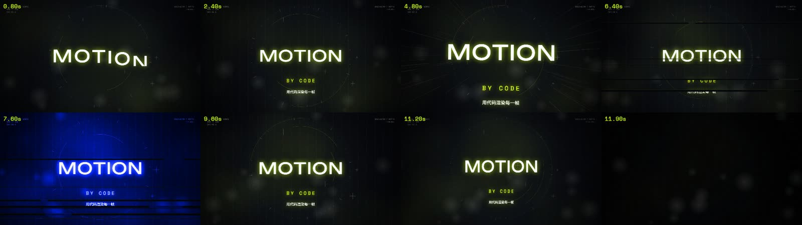
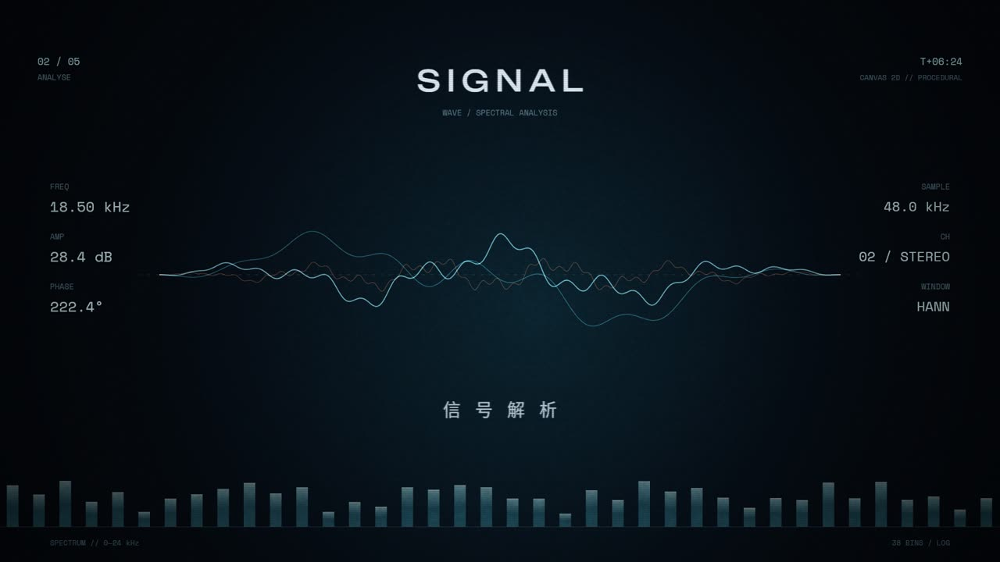
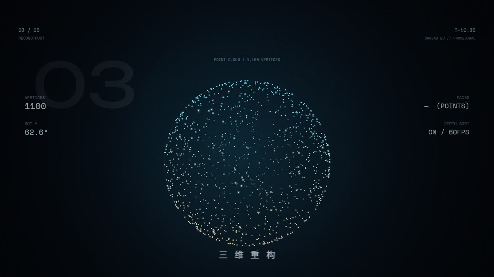
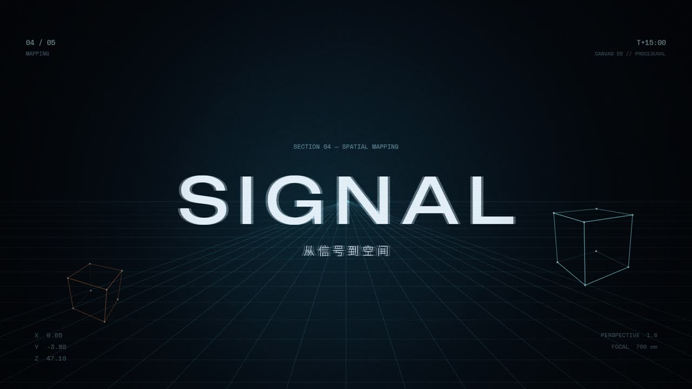
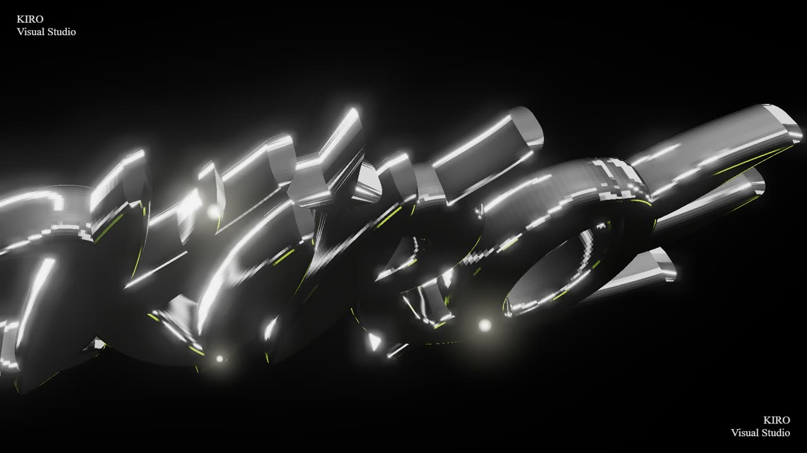

<div align="center">

# Motion Forge · 动效工坊

**用纯代码逐帧渲染，做出「像 AE 做的」视频片头 —— 不需要 Adobe，不需要一格素材。**

[](NOTICE)
[](package.json)
[](#环境要求)
[](CONTRIBUTING.md)

[English](README.en.md) · [快速开始](#快速开始) · [方法论](references/methodology.md) · [与上游的关系](#与上游的关系) · [已知限制](#已知限制)



<sub>上图为 `examples/opener.js` 一条命令输出的 8 格分镜（`sheet` 模式，约 3 秒生成）。</sub>

</div>

---

## 这是什么

一个**动效视频引擎**，外加一套把主观审美拆成可执行参数的方法论。

每一帧都由代码算出来：没有时间轴拖拽，没有素材合成，没有 AE 工程文件。你写脚本，脚本算出画面，画面直接进 ffmpeg。

```bash
git clone https://github.com/cxcmyt/motion-forge.git && cd motion-forge
npm install --omit=dev        # 约 98 MB，20 秒
node scripts/verify.js        # 七项自检
node examples/opener.js still 9.6 out/first.jpg
```

`verify.js` 全绿，你就有了一台会做动效的机器。

---

## 为什么需要它

思路源自 [KRYPT-123/kiro-motion-studio](https://github.com/KRYPT-123/kiro-motion-studio)，但那个仓库**开箱跑不起来** —— 不是配置问题，是四处硬编码与外部环境冲突。Motion Forge 把它修到能跑，补了两个可直接改字的模板，并把踩过的坑全部写进文档。

| 上游的问题 | 后果 | 这里的解法 |
|---|---|---|
| 4 个脚本写死 `/opt/pw-browsers/chromium-1243/chrome-linux64/chrome` | 除作者的 Linux 沙箱外，**必然崩溃** | `tools/chrome.js`：`KIRO_CHROME` → `ms-playwright` 缓存（版本倒序）→ 系统 Edge/Chrome 兜底 |
| 2D 脚本读 `../fonts/`，但仓库无该目录 | 启动即 `ENOENT` | 内置 6 个 WOFF（`assets/fonts/`），上游脚本一行不改即可跑 |
| 中文字形缺失（上游自认「常见坑」，未给解法） | 中文渲染成方块 | 运行时把 `msyh.ttc` / `PingFang.ttc` / Noto CJK 注册为别名 `Noto Sans SC` |
| 依赖散落在各 example 目录 | 要装三次，版本不一致 | 顶层单 `package.json` + `package-lock.json` |

另有 `KIRO_GL=d3d11`（Windows 独显）/ `metal`（macOS）开关，可从软渲染切硬件加速，实测提速数倍。

---

## 特性

- **两条渲染管线**：2D 走 `@napi-rs/canvas` → raw RGBA 管道直送 ffmpeg（**无损**）；3D 走 three.js + 无头 Chromium 截图。
- **跨平台**：Windows / macOS / Linux 同一份代码，浏览器路径自动解析。
- **零素材**：全片由数学与 hash 生成，同帧可复现，改动可 diff。
- **卡点到帧**：`B(n) = B0 + n·BP` 网格，镜头长度取整小节，不靠感觉排时间。
- **改字即换片**：两个模板各有一个 `CFG` 块，改 4 个常量换片。
- **自带质检**：`verify.js` 七项自检；`sheet` 模式 3 秒出分镜，先看节奏再渲全片。

---

## 预览

三个镜头，都是 `signal20.js` 的默认输出：

| 波形解析 | 点云重构 | 空间映射 |
|---|---|---|
|  |  |  |

3D 路线（three.js + 无头 Chromium，需先拉取上游脚本，见[可选：3D 管线](#可选3d-管线)）：



---

## 环境要求

| 依赖 | 版本 | 说明 |
|---|---|---|
| Node.js | ≥ 20 | 用到 `node:` 前缀与较新的 V8 |
| ffmpeg | ≥ 6 | 必须在 PATH 中；`ffprobe` 同 |
| Chromium | 任意近期版本 | Playwright 缓存会自动命中；没有则回退系统 Edge / Chrome |
| git | 任意 | 仅拉取可选的上游参考实现时需要 |

无 GPU 也能跑（默认 swiftshader 软渲染），代价是 3D 约 0.8 秒/帧。

---

## 快速开始

```bash
# 1. 装依赖（只装运行期依赖，约 98 MB）
npm install --omit=dev

# 2. 自检：node / ffmpeg / 浏览器 / 依赖 / 字体 / 中文字形
node scripts/verify.js

# 3. 出第一张图
node examples/opener.js still 9.6 out/first.jpg
```

`verify.js` 会明确告诉你哪一项没过、怎么修，不需要猜。最后一行若提示未拉取上游，属于正常：3D 是可选模块。

---

## 用法

所有脚本共用一套子命令：`still` / `sheet` / `video`。

```bash
# 单帧（改一帧看构图最快）
node examples/opener.js still 9.6 out/a.jpg

# 分镜缩略图（一张图看整条节奏，强烈建议每次改完先跑这个）
node examples/opener.js sheet 1.2,4.4,6.4,9.6,11.8 out/sheet.jpg

# 成片：video <fps> <输出路径>
node examples/opener.js video 60 out/opener-1080p60.mp4
node examples/signal20.js video 60 out/signal-1080p60.mp4

# 一次跑完所有样片（静帧 + 分镜，约 40 秒）
npm run render:samples
```

**质检流程固定三步**：`still` 看构图 → `sheet` 看节奏 → `video` 出片。先渲完整片再回看，时间成本高一个数量级。

### 可选：3D 管线

3D 用的是原作者写的场景脚本，按设计**不随本仓库分发**。需要时由你自己拉到你本地：

```bash
node scripts/fetch-upstream.js            # 克隆上游到 ./upstream/（已在 .gitignore 中）
npm run bundle:3d                         # esbuild 打包 three.js 场景
node upstream/examples/kiro-3d-logo/drive.js stills 1.0,5.0 out/3d
node upstream/examples/kiro-3d-logo/drive.js video out/3d/logo.mp4 0 300
```

`fetch-upstream.js` 会顺手把上游写死的浏览器路径改成 `tools/chrome.js` 的解析结果 —— 否则那 4 个脚本在你机器上必崩。原因与法律边界见 [NOTICE](NOTICE)。

---

## 改字即换片

两个模板顶部各有一个 `CFG` 块：

| 字段 | 含义 |
|---|---|
| `main` | 主标题（西文，Unbounded） |
| `sub` | 副标题（Space Mono） |
| `cn` | 中文行（`Noto Sans SC` 别名） |
| `bpm` | 节奏；`BP = 60 / bpm`，所有时间点由 `B(n) = B0 + n·BP` 推导 |
| `accent` | 主色 |

改完直接出片。**不要碰中间的函数** —— 时间轴与镜头开关都挂在 `SHOTS` 数组上，改函数会破坏卡点对齐。

---

## 方法论

完整版见 [`references/methodology.md`](references/methodology.md)，核心只有五条：

1. **每一帧都由代码算出**，所有随机来自确定性 hash，同帧可复现。
2. **先定网格再设计镜头**：先定 BPM 与相位，镜头长度取整小节。
3. **每镜头至少 4 层**：背景 → 装饰 → 主体 → 前景，后期再叠色差/颗粒/暗角。
4. **审美量化**：色差平时 1–1.5 px、鼓点 4–6 px；颗粒 0.05；暗角 0.35–0.46；crf 16–17。
5. **帧率分层**：主体 60fps 流畅，定格类元素 12fps 抖动，制造手作感。

---

## 目录结构

```
motion-forge/
├── SKILL.md                    技能入口（AI 助手可直接加载）
├── manifest.json               技能元数据
├── LICENSE / NOTICE            MIT · OFL-1.1 · 上游关系声明
├── examples/                   ★ 原创模板（MIT）
│   ├── opener.js               12 s 卡点片头，改 CFG 即换片
│   └── signal20.js             20 s 程序化科技片
├── assets/fonts/               6 个 WOFF（OFL-1.1）
├── tools/
│   └── chrome.js               跨平台 Chromium 定位器
├── scripts/
│   ├── verify.js               环境自检（七项）
│   ├── render-samples.js       一键批量出样片
│   └── fetch-upstream.js       按需拉取上游参考实现（可选）
├── references/
│   ├── methodology.md          方法论：时间轴 / 分层 / 参数表 / 质检清单
│   └── local-port.md           移植记录与 9 条踩坑
├── docs/preview/               README 用的预览图
└── upstream/                   ⚠ 运行时生成，不入库（由 fetch-upstream.js 拉取）
```

---

## 与上游的关系

| 维度 | 上游 | Motion Forge |
|---|---|---|
| 可运行性 | 4 处硬编码，开箱必崩 | 七项自检全绿，两条管线实测出片 |
| 浏览器 | 写死 Linux 沙箱路径 | 跨平台自动解析 |
| 字体 | 目录缺失 | 6 个 WOFF 内置 |
| 中文 | 无解法 | 系统字体别名注册 |
| 可改字模板 | 无 | `opener.js`（12 s）、`signal20.js`（20 s） |
| 自检 | 无 | `scripts/verify.js` |
| 文档 | 17.5 KB 方法论 | 速查 + 参数表 + 9 条坑 + 中英双语 |
| 代码分发 | 一个仓库装全部 | 上游代码不在本仓库内，需要就自己拉（见 NOTICE） |
| 许可 | 无 LICENSE | 原创 MIT · 字体 OFL-1.1 |

逐行改动清单见 [`references/local-port.md`](references/local-port.md)。

---

## 许可

- **本仓库全部内容**：MIT，见 [LICENSE](LICENSE)
- **`assets/fonts/`**：SIL Open Font License 1.1，来自 `@fontsource`
- **上游参考实现**：版权归 KRYPT-123，无 LICENSE → 保留所有权利。**不在本仓库内**，
  由 `scripts/fetch-upstream.js` 在你本机拉取，因此不受本仓库 MIT 覆盖

商用前请读一遍 [NOTICE](NOTICE)，两分钟能读完。

---

## 已知限制

1. **3D 有损**：中间帧走 JPEG q96，比 2D 的 raw RGBA 多一代压缩。严格调色交付需改为 PNG。
2. **软渲染慢**：3D 约 0.8 秒/帧，30 秒@60fps = 1800 帧，单进程 20 分钟以上，须按核数分段并行。
3. **3D 不是零依赖**：需要先跑 `fetch-upstream.js`，且上游脚本只做了浏览器路径这一处适配，其余问题未深挖。
4. **MV 路线未打通**：上游 `mv-lyrics/asr.py` 仍写死 whisper 模型与音频路径，需自备。
5. **不适合实拍**：没有素材解码与剪辑能力，只做「算出来的画面」。
6. **上游代码不可维护**：变量名是 `BP/B0/oC/oE` 一类缩写，无测试、无类型。能读，别当库改。

---

## 该选哪条路

| 需求 | 建议 |
|---|---|
| 一次性、画面要极精确卡点 | **Motion Forge**（手写逐帧，自由度最高，零工程护栏） |
| 要交给团队、要参数化批量 | [Remotion](https://www.remotion.dev/)（React 组件 + 官方渲染器，工程化最完整） |
| 要最快出第一版、希望被 lint 拦住低级错误 | [HyperFrames](https://hyperframes.dev/)（单 HTML + GSAP 时间线） |

三者做同一支 12 秒片头的实测对比：本方案 120 秒 / Remotion 约 90 秒（并发 6）/ HyperFrames 31 秒。速度与工程保障成反比，与灵活度成正比。

---

## 贡献

欢迎 PR。请先读 [CONTRIBUTING.md](CONTRIBUTING.md)。两条硬规矩：**不要提交 `upstream/`**（那是本机运行时产物，已在 `.gitignore` 中），**不要改动 `examples/` 里 `CFG` 区块之外的时间轴逻辑**。

## 致谢

- **KRYPT-123** —— 方法论与原始实现，[上游仓库](https://github.com/KRYPT-123/kiro-motion-studio)
- `@napi-rs/canvas`、`three.js`、`playwright-core`、`esbuild` —— 让"纯代码出片"成为可能
- `@fontsource` —— 字体分发
